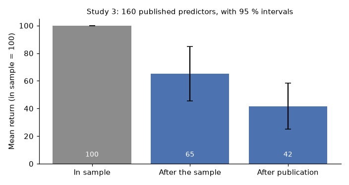
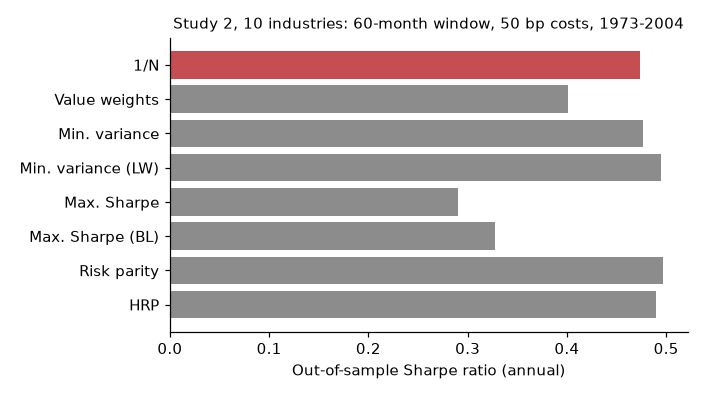

# Quant Research Lab

`qrlab` is a Python framework for quantitative financial research, portfolio analytics and
backtesting, with a Windows desktop app on top of the same library. Correctness,
reproducibility and methodological rigour come before speed or feature count.

> **Status:** version 1.0 is in preparation. The public API is frozen
> ([compatibility policy](https://github.com/alessandroszn/quant-research-lab/blob/main/docs/compatibility.md)). See [`CHANGELOG.md`](https://github.com/alessandroszn/quant-research-lab/blob/main/CHANGELOG.md) and the
> [roadmap](https://github.com/alessandroszn/quant-research-lab/blob/main/docs/ROADMAP.md).

*Research analytics, not investment advice.*

## What it does

- **Portfolio and ETF analytics.**
  - Broker exports are imported through explicit mappings and replayed into positions and
    cash.
  - Performance: time- and money-weighted returns, labelled and never mixed, and an exact P&L
    breakdown.
  - Risk: covariance estimators, risk contributions, VaR/ES with backtests.
  - ETF look-through and overlap, health checks, historical and hypothetical stress tests, and
    Monte Carlo projections reported as distributions.
- **A research lab.**
  - Optimisation: minimum variance, mean-variance, maximum Sharpe, Black-Litterman, risk
    parity, maximum diversification, HRP.
  - Look-ahead-free backtests with execution lags, costs and taxes, gross and net side by side.
  - Time-ordered validation; attribution; inference with HAC errors and the bootstrap;
    multiple-testing corrections and the deflated Sharpe ratio.
- **One experiment runner.** Every analysis is a config file. The runner records:
  - its inputs and their hashes;
  - the code version;
  - the number of configurations tried.

  It also labels every result in-sample, out-of-sample or descriptive. The command line, the
  desktop app and scripts all use it.
- **A Windows desktop app** with no financial logic of its own, in English and Italian.

## Four reproducible studies

Each study was specified in a design note before any result was seen, then run on public data
through the experiment runner. Null results are reported as results.

| Study | Main finding |
|---|---|
| [1. Volatility-managed factors](https://github.com/alessandroszn/quant-research-lab/blob/main/docs/studies/01-volatility-managed.md) | In-sample alphas do not turn into real-time gains for five of six factors after costs; momentum is the exception (moderate evidence). |
| [2. 1/N against optimised portfolios](https://github.com/alessandroszn/quant-research-lab/blob/main/docs/studies/02-one-over-n.md) | No optimised strategy has a significantly higher net Sharpe ratio than 1/N, in either universe, window or cost level. |
| [3. The factor zoo](https://github.com/alessandroszn/quant-research-lab/blob/main/docs/studies/03-factor-zoo.md) | Most published predictors pass a single test; a third to a half would fail a multiple-testing bar. Returns fall 35 % after the sample and 58 % after publication. |
| [4. Rebalancing for a EUR ETF investor](https://github.com/alessandroszn/quant-research-lab/blob/main/docs/studies/04-rebalancing.md) | Under Italian capital-gains tax, monthly rebalancing costs about €14k over 20 years against annual and buys almost no risk control. |





The figures are drawn from the study records by `scripts/readme_figures.py`.

## Install

```bash
pip install "quant-research-lab[app,parquet]"
```

The extras:

- `app`: the desktop app, `qrlab-app` (PySide6, LGPL-3.0);
- `parquet`: Parquet files (pyarrow), needed by study 3.

The Windows program and its installer are attached to each GitHub release. They are not
code-signed: check them against `SHA256SUMS.txt`.

From source, with [uv](https://docs.astral.sh/uv/):

```bash
uv sync
uv run qrlab kinds
uv run qrlab run configs/experiments/example_risk_report.toml
```

The [documentation](https://alessandroszn.github.io/quant-research-lab/) covers the rest:

- getting started;
- guides to experiments, the experiment kinds, the app and reproducing the studies;
- one methodology page per risk in the [risk register](https://github.com/alessandroszn/quant-research-lab/blob/main/docs/ARCHITECTURE.md), with its known
  limits;
- the API reference.

## Quality

```bash
uv run ruff format --check . && uv run ruff check . && uv run mypy && uv run pytest
```

- **Tests:** about 2,000 deterministic tests, with 100 % coverage and no network. Financial
  formulas have hand-calculated examples and cross-checks against statsmodels, SciPy and
  scikit-learn.
- **Typing and layering:** mypy runs strict, and a test enforces the layering of the
  subpackages.
- **CI:** Linux and Windows, Python 3.11 and 3.13.
- **Documentation:** built with warnings treated as errors.
- **Windows build:** the frozen program must reproduce the source results byte for byte.

## Data and privacy

Raw data are stored unchanged with their provenance. Each source's terms of use are checked and
recorded; see [data sources](https://github.com/alessandroszn/quant-research-lab/blob/main/docs/guides/data-sources.md). Real portfolio data lives only in
the git-ignored `data/` folder, never in tests, examples or published reports.

## Citation and licence

If you use Quant Research Lab or its studies, please cite it; see [`CITATION.cff`](https://github.com/alessandroszn/quant-research-lab/blob/main/CITATION.cff).

- **Code:** [BSD-3-Clause](https://github.com/alessandroszn/quant-research-lab/blob/main/LICENSE).
- **Documentation and study reports:**
  [CC BY 4.0](https://creativecommons.org/licenses/by/4.0/).
- **Third-party software in the Windows program:** listed in its `THIRD_PARTY_NOTICES.txt`.

Contributions are welcome; see [`CONTRIBUTING.md`](https://github.com/alessandroszn/quant-research-lab/blob/main/CONTRIBUTING.md) and
[`SECURITY.md`](https://github.com/alessandroszn/quant-research-lab/blob/main/SECURITY.md).
